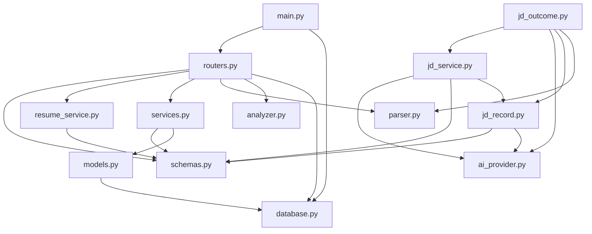

# RoleRadar

RoleRadar is an evidence-grounded AI job analysis platform for students and early-career candidates.

The project is evolving from a rule-based full-stack baseline into a tested AI workflow that structures job descriptions, connects requirements to real candidate evidence, explains skill gaps and uncertainty, and tracks job applications.

## Current Status

- V1 / Stages 1-4 / Days 1-14: complete
- V2 / Stage 5 / Days 15-19: engineering credibility foundation complete
- V2 / Stage 6 / Days 20-23: Resume intake and evidence-backed Student Profile complete
- V2 / Stage 7 / Days 24-27: structured LLM JD parser complete
- Current next step: V2 / Stage 8 / Day 28, evidence-grounded matching
- Latest independently verified committed implementation baseline: commit `e338441`, 461 tests passing, 6 Application rows and 0 Student Profile rows in the real local database

V2 is not complete yet. It closes only after Stage 8 / Day 30 passes evaluation, regression, documentation, and the end-to-end Streamlit demo review.

## V1 Baseline Features

- Extract required skills from job descriptions
- Compare detected job skills with user skills
- Calculate a FitScore
- Display matched and missing skills
- Save application records to SQLite
- Track application status changes
- Display total applications, status counts, and average FitScore
- Visualize application status and FitScore distributions
- Display the Top 5 Missing Skills across saved applications
- Preserve application history across backend and frontend restarts

## How V1 Works

1. The user enters a job description and a comma-separated skills list.
2. The Streamlit frontend sends the input to `POST /analyze-job`.
3. The FastAPI backend extracts job skills and calculates matched skills, missing skills, and FitScore.
4. The frontend displays the analysis result.
5. The user adds company, job title, and application status information.
6. The frontend saves the application through `POST /applications`.
7. The Dashboard loads saved records through `GET /applications`.
8. The user can update an application status through `PATCH /applications/{application_id}`.
9. Dashboard metrics, charts, and application history refresh from the updated records.

## V2 Capabilities Delivered Through Stage 7

- Validate pasted Resume text and extract text from a controlled single-PDF upload
- Model education, experience, projects, courses, certifications, skills, preferences, work authorization, and skill evidence in a nested `StudentProfile`
- Save, replace, reload, edit, and explicitly confirm a Profile while resetting confirmation after content changes
- Call an OpenAI provider through a vendor-neutral `AIProvider` interface
- Convert an unstructured JD into a fixed 13-field `StructuredJobDescription` with strict JSON Schema and Pydantic validation
- Separate required skills, preferred skills, hard constraints, and uncertain requirements
- Bind extracted requirements to exact evidence excerpts and verify that each excerpt occurs in the source JD
- Record provider, requested and returned model, prompt/parser/schema versions, latency, token usage, request options, timestamp, and a JD fingerprint
- Export and read validated local parsing records without persisting the raw provider response
- Fall back once to the frozen V1 rule parser for known LLM failures and label that outcome as `rule_fallback`
- Replay six frozen synthetic JD records offline for rule-versus-LLM comparison without network access or API cost

Current V2 boundary:

- Resume intake does not automatically turn Resume text into a Student Profile; the user creates, corrects, saves, and confirms the Profile
- The Stage 7 LLM parser is currently a tested backend service and evaluation capability, not a FastAPI endpoint or Streamlit control
- Profile-to-JD matching, matched/missing/uncertain results, deterministic Alignment Score, the 30-50-case Stage 8 evaluation set, and the final V2 UI demo remain for Days 28-30

The planned V2 product flow is:

```text
confirmed StudentProfile
+ validated LLM JobDescriptionRecord
→ evidence-grounded matched / missing / uncertain results
→ separately reported hard constraints
→ deterministic, reproducible Alignment Score
→ evaluation and user-facing Streamlit demo
```

## Progress

### Day 1

Completed:

- Set up the project folder structure
- Created and activated a Python virtual environment
- Built a minimal FastAPI backend
- Added backend endpoints:
  - `GET /`
  - `GET /health`
  - `POST /parse-jd`
- Added a rule-based JD parser using a known skills list
- Built a minimal Streamlit frontend
- Added a JD text area and character counter
- Verified backend and frontend locally

### Day 2

Completed:

- Added `requests` to the frontend dependencies
- Connected the Streamlit frontend to the FastAPI `/parse-jd` endpoint
- Added an `Analyze JD` button
- Sent JD text from the frontend to the backend using a POST request
- Displayed detected skills in the frontend
- Added a warning for empty JD input
- Committed the Day 2 frontend-backend integration

### Day 3

Completed:

- Refactored JD parsing logic into a separate parser module
- Added `backend/app/parser.py`
- Moved `KNOWN_SKILLS` into the parser module
- Added `extract_skills()` helper function
- Updated `/parse-jd` to call `extract_skills()`
- Verified the FastAPI `/parse-jd` endpoint after refactor
- Verified the Streamlit frontend still displays detected skills

### Day 4

Completed:

- Started Stage 2 : SkillMap and FitScore preparation
- Added a user skills input field to the Streamlit frontend
- Parsed comma-separated user skills into a Python list
- Trimmed extra spaces from user skill input
- Filtered out empty skill entries
- Displayed user skills in the frontend
- Verified the existing JD skill extraction still works after the frontend update
- Committed and pushed the Day 4 user skills input features

### Day 5

Completed:

- Started comparing detected JD skills with user skills
- Added `jd_skills` as a named frontend variable from the `parse-jd` response
- Added case-insensitive matching between JD skills and user skills
- Displayed matched skills in the Streamlit frontend
- Displayed missing skills in the Streamlit frontend
- Added empty-state messages for no matched skills and no missing skills
- Improved user skills display formatting
- Kept the comparison logic in the frontend for now
- Did not implement FitScore yet

### Day 6

Completed:

- Added a basic FitScore calculation
- Calculated FitScore from matched skills and detected JD skills
- Formatted FitScore as a rounded percentage
- Added protection against division by ZERO
- Added an empty state when no known skills are detected
- Hid matched and missing skill sections when no JD skills are detected
- Verified partial-match, full-match, and empty-detection scenarios
- Kept FitScore calculation in the Streamlit frontend for now

### Day 7

Completed:

- Added `backend/app/analyzer.py`
- Added the `analyze_skill_gap()` backend helper function
- Moved case-insensitive skill comparison into the backend
- Moved matched skills, missing skills, and FitScore calculation into the backend
- Added the `JobAnalysisRequest` Pydantic model
- Added the `POST /analyze-job` endpoint
- Reused `extract_skills()` inside the new analysis endpoint
- Updated the Streamlit frontend to send JD text and user skills together
- Updated the frontend to read analysis results from the backend
- Removed duplicate skill-gap and FitScore calculations from the frontend
- Verified partial-match, full-match, no-match, and empty-detection scenarios
- Kept the existing `POST /parse-jd` endpoint available


### Day 8

Completed:

- Started Stage 3: Application Tracker
- Added the `ApplicationCreate` Pydantic request model
- Defined company, job title, status, FitScore, matched skills, and missing skills fields
- Added temporary in-memory application storage
- Added the `POST /applications` endpoint
- Converted validated Pydantic payloads into dictionaries
- Added temporary sequential application IDs
- Verified successful application creation through Swagger
- Verified invalid JSON and invalid FitScore validation errors
- Documented that in-memory records are lost when the backend restarts
- Identified duplicate POST requests as a limitation for future handling

### Day 9

Completed:

- Replaced temporary in-memory application storage with SQLite
- Added SQLAlchemy as the backend ORM
- Added the database engine, session factory, declarative base, and per-request database dependency
- Added the `Application` SQLAlchemy ORM model
- Created the `applications` database table
- Added database-generated application IDs and creation timestamps
- Stored matched and missing skills using JSON columns
- Updated `POST /applications` to persist records in SQLite
- Added the `ApplicationResponse` Pydantic response model
- Added the `GET /applications` endpoint
- Verified saved application records through Swagger
- Verified that application records persist after a backend restart
- Added the local SQLite database file to `.gitignore`


### Day 10

Completed:

- Connected the Streamlit frontend to the persistent Application Tracker API
- Added Streamlit session state for preserving analysis results across reruns
- Added company, job title, and application status inputs
- Reused FitScore, matched skills, and missing skills in application payloads
- Added the `Save Application` frontend workflow
- Added required-field validation before saving
- Added current-session duplicate submission protection
- Connected the frontend to `GET /applications`
- Added expandable application history records
- Verified application creation through the frontend
- Verified that application history persists after backend and frontend restarts

### Day 11

Completed:

- Added the `ApplicationStatusUpdate` Pydantic request model
- Added the `PATCH /applications/{application_id}` endpoint
- Added application ID path parameter handling
- Queried application records by primary key
- Added `404 Not Found` handling for missing application records
- Added application status updates using SQLAlchemy ORM objects
- Committed and refreshed updated application records
- Returned updated records using the `ApplicationResponse` model
- Verified successful status updates through Swagger
- Verified missing-record errors through Swagger
- Added shared application status options in the Streamlit frontend
- Added per-record status selectors and update buttons
- Connected the frontend to the application status PATCH endpoint
- Added automatic history refresh after successful updates
- Disabled status update buttons when the selected status is unchanged
- Verified that updated statuses persist after backend and frontend restarts

### Day 12

Completed:

- Formally completed Stage 3: Application Tracker
- Started Stage 4: Dashboard and V1 Completion
- Reused application records returned by `GET /applications`
- Added total application count aggregation
- Added application status count aggregation
- Added average FitScore calculation
- Added empty-data and division-by-zero protection
- Added Dashboard metric cards using Streamlit columns
- Displayed Interested, Applied, Interviewing, Offer, and Rejected counts
- Verified Dashboard metrics with multiple application records
- Verified the Dashboard with an empty database
- Verified the Dashboard with a single application record
- Confirmed that Application History still displays correctly below the Dashboard

### Day 13

Completed:

- Added an Application Status Distribution bar chart
- Preserved the application workflow order in the status chart
- Defined four non-overlapping FitScore ranges
- Added FitScore range frequency counting
- Added a FitScore Distribution bar chart
- Flattened nested missing-skills lists across application records
- Added missing-skill frequency counting
- Sorted missing skills by frequency and selected the Top 5
- Added a horizontal Top Missing Skills bar chart
- Added an empty state when no missing skills are found
- Reused real application records returned by `GET /applications`
- Used Streamlit built-in charts without adding new dependencies
- Verified multiple-record, empty-database, single-record, and empty-missing-skills scenarios
- Confirmed that Application History still works below the Dashboard

### Day 14

Completed:

- Ran the final V1 regression test using an isolated SQLite database
- Verified job analysis, FitScore, matched skills, and missing skills
- Confirmed that analysis does not create an application record
- Verified application saving through the complete frontend-backend workflow
- Verified Dashboard metrics, charts, Top Missing Skills, and Application History
- Verified application status updates and Dashboard synchronization
- Verified data persistence after backend and frontend restarts
- Restored the original local application database after regression testing
- Cleaned frontend formatting without changing application behavior
- Added V1 features and end-to-end workflow documentation
- Verified all Python files with syntax and whitespace checks
- Validated the final V1 demo flow
- Completed Stage 4 and RoleRadar V1

### Day 15

Completed:

- Added pytest as a backend testing dependency
- Created the initial backend test directory
- Added the first isolated unit test for the rule-based JD parser
- Verified pytest discovery and assertion behavior
- Confirmed that the parser test does not access the SQLite database
- Ignored pytest cache files in Git

### Day 16

Completed:

- Expanded parser unit tests with normal, case-insensitive, empty, and unknown-skill cases
- Added a regression test for overlapping skill names
- Fixed substring matching so Java is not detected inside JavaScript
- Preserved support for skill names containing special characters, such as C++
- Added parameterized analyzer tests for full, partial, no-match, and empty-JD cases
- Used `pytest.approx()` for floating-point FitScore comparisons
- Verified all ten parser and analyzer tests without accessing SQLite

### Day 17

Completed:

- Added FastAPI API tests using TestClient and HTTPX2
- Created an isolated temporary SQLite database for each test
- Overrode the FastAPI database dependency so tests never access the real database
- Added POST, GET, and PATCH tests for Applications
- Added 404 coverage for missing applications
- Added 422 coverage for invalid request payloads
- Verified all 15 backend tests
- Confirmed that the real SQLite database remained unchanged

### Day 18

Completed:

- Made the backend database URL configurable through an environment variable
- Made the frontend API base URL configurable through an environment variable
- Preserved local development defaults for both configuration values
- Added a request timeout to all frontend API calls
- Added timeout, connection, HTTP, and general request error handling
- Prevented failed analysis requests from displaying stale results
- Distinguished failed application-history loading from a valid empty history
- Added a safe environment-variable example file
- Verified both successful requests and backend connection failures
- Confirmed all 15 backend tests pass and the real database remains unchanged

### Day 19

Completed:

- Separated API data contracts into `backend/app/schemas.py`
- Separated Application database operations into `backend/app/services.py`
- Moved all seven API operations into `backend/app/routers.py`
- Kept HTTP-specific validation and 404 handling in the Router layer
- Kept ORM creation, queries, updates, commits, and refreshes in the Service layer
- Reduced `backend/app/main.py` to application creation and Router assembly
- Preserved all existing API endpoints and response formats
- Verified all 15 backend tests after the refactor
- Manually verified health, analysis, POST, GET, PATCH, 404, and 422 behavior
- Used a temporary SQLite database for manual verification
- Confirmed that the real SQLite database still contains six Application records

### Day 20

Completed:

- Added validated resume intake from pasted plain text
- Added controlled single-PDF resume upload and text extraction
- Added shared response fields for resume text, character count, source type, and filename
- Added PDF type, size, header, encryption, damage, and extractable-text validation
- Limited PDF uploads to 5 MB
- Added `pypdf` and `python-multipart` backend dependencies
- Added a synthetic PDF fixture containing no personal data
- Added 11 isolated resume API tests that do not access the real database
- Connected both resume intake methods to the Streamlit frontend
- Verified successful text and PDF flows, validation errors, and backend connection failures
- Confirmed all 26 backend tests pass and the real database remains unchanged

### Day 21

Completed:

- Added a `StudentProfile` Pydantic schema with nested models for education, experience, projects, courses, certifications, and preferences
- Added a shared `ProfileBaseModel` base class that rejects unexpected extra fields
- Added a `WorkAuthorizationStatus` enum and a `WorkAuthorization` nested model with country, status, and sponsorship fields
- Added a `WorkMode` enum and a `Preferences` nested model for desired roles, locations, and work mode
- Used empty lists as the default for repeatable sections and `None` for sections that may be entirely unfilled
- Represented dates as plain strings to accommodate ongoing entries and partial dates
- Added 10 isolated schema tests covering full payloads, minimal payloads, list-instance isolation, serialization round-trips, invalid enum values, missing/None required fields, empty-string optional fields, and rejected extra fields
- Confirmed all 36 backend tests pass and the real database remains unchanged
- Did not add SkillEvidence, profile persistence, profile API endpoints, or a profile editing UI

### Day 22

Completed:

- Added an `EvidenceSourceType` enum for the limited set of evidence sources (education, experience, project, course, certification, resume)
- Added a `SkillEvidence` Pydantic model with required skill and evidence-text fields, an optional source ID, a 0.0–1.0 confidence score, and a three-state user-confirmation flag
- Kept `confidence` as `None` when unset instead of defaulting to 0, and kept `user_confirmed` as `None` until reviewed instead of defaulting to `False`
- Required `skill` and `evidence_text` to be non-blank after stripping leading and trailing whitespace
- Added `skill_evidence` to `StudentProfile` as an independent list alongside the existing self-reported `skills` list
- Added 23 isolated schema tests covering full payloads, multiple evidence entries per skill, serialization round-trips, invalid enum values, confidence boundaries, three-state confirmation values, blank/whitespace-only required text, missing/None required fields, and rejected extra fields
- Confirmed all 59 backend tests pass and the real database remains unchanged
- Did not add profile persistence, profile API endpoints, or a profile editing UI

### Day 23

Completed:

- Added a `StudentProfileRecord` SQLAlchemy model storing a full `StudentProfile` as a JSON snapshot, plus a confirmation flag and timestamps
- Reused `from_attributes` validation so `ProfileResponse` converts the stored JSON back into a validated `StudentProfile`
- Added a Profile service layer for reading, creating-or-replacing, and confirming the saved Profile
- Added `GET /profile`, `PUT /profile`, and `PATCH /profile/confirmation` endpoints
- Reset Profile confirmation to unconfirmed whenever the content is replaced
- Added 10 isolated Profile persistence tests covering creation, replacement, confirmation, 404s, invalid payloads, cross-session reads, and independence from Application records
- Added a Streamlit Student Profile section for loading, editing as JSON, and saving a Profile
- Added Skill Evidence detail display and a Profile confirmation button in the frontend
- Manually verified save, restart persistence, re-confirmation after edits, and backend-connection error handling using a temporary database
- Confirmed all 69 backend tests pass and the real database's Application records remain unchanged
- Did not add authentication, multiple profiles, database IDs for nested models, or an Alignment Score

### Day 24

Completed:

- Started Stage 7: LLM JD Parser
- Added the official OpenAI Python SDK as a backend dependency
- Added `OPENAI_API_KEY`, `OPENAI_MODEL`, `OPENAI_TIMEOUT_SECONDS`, and `OPENAI_MAX_RETRIES` configuration placeholders
- Added `backend/app/ai_provider.py` with a vendor-neutral `AIProvider` interface, a frozen `GenerationResult`, and six domain error types
- Added an `OpenAIProvider` implementation that calls the Responses API and returns the text, the model actually reported by the provider, the measured latency, and token usage
- Delegated timeout and retry handling to the official SDK instead of adding a second retry loop
- Translated SDK timeout, connection, rate-limit, and API status errors into RoleRadar domain errors with fixed, secret-free messages
- Rejected unfinished responses before reading any text so truncated output is never returned as a successful result
- Centralised configuration validation in `OpenAIProviderConfig.__post_init__` so the environment and explicit-configuration paths share one contract
- Hid the API key from the configuration `repr` and suppressed SDK exception chaining in tracebacks
- Added an optional `reasoning_effort` argument that stays omitted unless explicitly provided
- Added 65 isolated provider tests that mock the SDK and require no API key, no network access, and no cost
- Verified one approved live call against a fictional job description: 105 input tokens, 37 output tokens, 2.649 s latency, and roughly $0.00007 in cost
- Confirmed all 134 backend tests pass and the real database remains unchanged
- Did not add a structured job-description schema, a parsing endpoint, prompt or parser versioning, or a rule-versus-LLM comparison

### Day 25

Completed:

- Added a `StructuredJobDescription` Pydantic schema with a dedicated `JobDescriptionBaseModel` base, a JD-specific `JobWorkMode` enum, and a reusable `JobRequirement` model that binds each requirement to its supporting job-posting phrase
- Made every job-description field required in the schema and expressed unknown facts as `null` or an empty list, so the generated JSON Schema satisfies strict Structured Outputs
- Kept the schema separate from `StudentProfile`, because a candidate's own status and preferences are not the same contract as a posting's requirements
- Added an optional `JsonSchemaFormat` argument to the provider so callers can request strict Structured Outputs without the provider importing any business model
- Added `AIProviderRefusalError` and refusal detection so a refused response is no longer reported as missing text
- Added `backend/app/jd_service.py` with fixed extraction instructions, delimiter-wrapped postings, one provider call, JSON decoding, Pydantic validation, and verbatim evidence verification
- Treated the job posting as untrusted data and instructed the parser never to follow instructions found inside it
- Returned provider metadata alongside the parsed result so later reproducibility work has the model, latency, and token usage available
- Added 101 isolated schema, provider, and service tests that mock the SDK and require no API key, no network access, and no cost
- Verified two approved live calls against a fictional job posting; the first exposed education and work-authorization requirements being filed as skills, and the second confirmed the corrected instructions produce skills-only `required_skills` and populated `hard_constraints`
- Recorded the live measurements: 668/271 tokens at 5.43 s and 735/260 tokens at 3.703 s, for roughly $0.00092 in total cost
- Confirmed all 235 backend tests pass and the real database remains unchanged
- Did not add a parsing endpoint or UI control, prompt or parser versioning, a rule-versus-LLM comparison, or any match scoring

### Day 26

Completed:

- Clarified the extraction instructions so an education or work-authorization requirement is recorded in its own field, is never filed as a skill, and also appears in `hard_constraints` when the posting states it as mandatory
- Stated explicitly that preferred, optional, alternative, vague, or contradictory wording must never be promoted to a hard constraint, and that `hard_constraints` records what a posting demands rather than a judgement about a candidate
- Added independent `PROMPT_VERSION`, `PARSER_VERSION`, and `SCHEMA_VERSION` constants, each living in the module that owns the thing it versions
- Extended `GenerationResult` so the provider reports its own identity, the model it actually requested, and the output limit and reasoning effort it actually sent, with omitted options recorded as unknown rather than guessed
- Added `backend/app/jd_record.py` with a `ParseMetadata` contract, a SHA-256 fingerprint of the stripped job posting, a UTC timestamp, and an explicit allow list of the fields that may be written to disk
- Returned a `JobDescriptionRecord` from the parser that carries the validated job description, the traceability metadata, and the in-memory generation result
- Kept the raw provider response out of exported files: the allow list never serialises `generation`, so `generation.text` never reaches disk; the validated record still stores `evidence_text` quotes, which are excerpts of the posting by design
- Added explicit local JSON export that refuses to overwrite an existing file, and a read-back path that rejects unsupported record or schema versions, missing fields, unexpected fields, and content that no longer matches the schema
- Left parsing itself free of disk writes; exporting is always an explicit call by the caller
- Ignored `backend/records/` in Git because a record contains real posting content; the fingerprint is only there to link results from the same input and offers no anonymisation, so exported records stay local business data
- Added 104 isolated tests that mock the SDK and require no API key, no network access, and no cost: 80 record tests, 18 more service tests, and 6 more provider tests covering the new call-identity fields
- Confirmed all 339 backend tests pass and the real database remains unchanged
- Did not add database tables, a version registry, a logging platform, a failure audit trail, an endpoint or UI control, a rule-versus-LLM comparison, or any match scoring

### Day 27

Completed:

- Froze six short synthetic job postings with manual expectations in `backend/evaluation/jd_cases.py`, written before any model output was collected and versioned by `CASE_SET_VERSION`
- Covered clear required and preferred skills, mandatory degree and work-authorization gates, unstated fields that must stay null, a negated skill, an alternative branch with a conflicting seniority claim, and technologies outside `KNOWN_SKILLS` combined with an instruction injected into the posting
- Marked cells the prompt does not decide as not graded with a recorded reason, so prompt ambiguity is never counted as a model error
- Added `backend/app/jd_outcome.py`, a small application level entry point that returns either an `llm` outcome carrying a validated record or a `rule_fallback` outcome carrying only the V1 skill list and a fixed failure category
- Mapped nine known failure types one to one onto the existing exception classes instead of parsing error message text, and kept configuration errors, an empty posting, and unexpected errors propagating rather than becoming a silent fallback
- Forced the fallback to make no second AI request, never label rule skills as required, and never fabricate an empty but complete `StructuredJobDescription`
- Added `backend/evaluation/batch_contract.py` so the comparison and the collection tool share one definition of the approved batch: the posting fingerprint, the prompt, parser and schema versions, the provider, the requested model, the requested output limit and the requested reasoning effort
- Added `backend/evaluation/compare_jd.py`, an offline comparison that replays saved records and never contacts a provider, pairing a record to a case only when every field of that contract matches, while the returned model is recorded as observed rather than forced to equal the requested name
- Reported an unmatched case as not measured, a record from another batch as a named skip, duplicate matches as ambiguous, and missing token counts as unknown rather than zero
- Added `backend/evaluation/collect_jd.py` for the historical user-approved collection batch, with strict argument parsing so a missing `--only` value, an unknown flag or an unknown case id exits non-zero
- Sealed that live entry point once the batch was complete: the module no longer imports a provider, never loads an API key, and has no collection loop, so `--send` is refused with a non-zero exit and no send path is left to call; it now only previews which cases have a record and the subtotal of the usage those records report
- After collection, an offline repair attempted a character-ratio cost-reservation heuristic; no new live collection used it, it was never proven to be a reliable upper bound, and the heuristic was removed when the live entry point was sealed
- Collected six responses across eight user-run requests under two separately approved batches; the known usage is estimated at $0.0019656, plus an unknown amount for the two failed requests
- Recorded 4 of 6 cases usable on the first attempt and 6 of 6 after one retry each for JD-05 and JD-06, with 100 of 104 graded checks passing against the stored records; the retries did not diagnose the original evidence failures, whose cause stays unconfirmed
- Kept the whole test suite offline: 122 net-new tests relative to Day 26 mock the SDK and need no API key, no network access, and no cost
- Confirmed all 461 backend tests pass and the real database remains unchanged
- Did not change the prompt, the schema, the provider, or `KNOWN_SKILLS`, and did not add match scoring, an endpoint, or a UI control

## Tech Stack

- Python
- FastAPI
- Uvicorn
- Streamlit
- SQLite
- SQLAlchemy
- pytest
- HTTPX2
- pypdf
- python-multipart
- openai
- Jinja2 (server-rendered pages of the experience library)

Planned later:

- PostgreSQL
- Plotly

## Project Structure

```txt
roleradar/
├── backend/
│   ├── app/
│   │   ├── ai_provider.py
│   │   ├── analysis_contracts.py  # U2 evidence analysis: what a task asks and gets back
│   │   ├── analyzer.py
│   │   ├── database.py
│   │   ├── experience_analysis.py # U2 evidence analysis of chosen experiences
│   │   ├── jd_outcome.py
│   │   ├── jd_record.py
│   │   ├── jd_service.py
│   │   ├── job_analysis/   # v0.1 U2-A2 job analysis pages and temporary tasks
│   │   ├── library/        # v0.1 U1 experience library: own database and pages
│   │   ├── main.py
│   │   ├── match_service.py
│   │   ├── models.py
│   │   ├── outbound_review.py     # what must not go out to an analysis service
│   │   ├── parser.py
│   │   ├── resume_service.py
│   │   ├── routers.py
│   │   ├── schemas.py
│   │   ├── services.py
│   │   └── web_main.py     # entry point of the experience library web app
│   ├── evaluation/
│   │   ├── batch_contract.py
│   │   ├── collect_jd.py
│   │   ├── compare_jd.py
│   │   ├── day27_report.md
│   │   └── jd_cases.py
│   ├── records/          # Saved parse records, gitignored
│   ├── tests/
│   │   ├── fixtures/
│   │   │   └── synthetic_resume.pdf
│   │   ├── library/        # library tests and the isolated test launcher
│   │   ├── test_ai_provider.py
│   │   ├── test_collect_jd.py
│   │   ├── test_compare_jd.py
│   │   ├── test_jd_outcome.py
│   │   ├── test_jd_record.py
│   │   ├── test_jd_service.py
│   │   ├── test_structured_jd.py
│   │   ├── test_analyzer.py
│   │   ├── test_applications.py
│   │   ├── test_parser.py
│   │   ├── test_resumes.py
│   │   ├── test_student_profile.py
│   │   ├── test_skill_evidence.py
│   │   └── test_profile_persistence.py
│   ├── requirements.txt
│   └── roleradar.db        # Local SQLite database, gitignored
├── frontend/
│   ├── requirements.txt
│   └── streamlit_app.py
├── .env.example
├── .gitignore
└── README.md
```

## Backend Architecture

The backend uses a basic responsibility-separated structure:

| Module | Responsibility |
| --- | --- |
| `main.py` | Create the FastAPI application and register the Router |
| `routers.py` | Define HTTP endpoints, inject dependencies, and translate business results into HTTP responses |
| `schemas.py` | Define Pydantic request and response contracts |
| `resume_service.py` | Validate resume text and extract text from supported PDF files |
| `services.py` | Perform Application business and database operations |
| `models.py` | Define SQLAlchemy ORM models and database-table mappings |
| `database.py` | Configure the database engine, sessions, and declarative base |
| `parser.py` | Extract known skills from job-description text |
| `analyzer.py` | Calculate matched skills, missing skills, and FitScore |
| `ai_provider.py` | Call the configured AI provider through the Responses API and translate provider errors, timeouts, and usage metadata |
| `jd_service.py` | Turn a job posting into a validated `StructuredJobDescription` and reject requirements whose evidence is not in the posting |
| `jd_record.py` | Attach traceability metadata to a parse result and export or reload it as a local JSON record without ever writing the raw provider response |
| `jd_outcome.py` | Wrap the parser in one application level entry point that reports either a validated LLM record or a clearly labelled V1 rule fallback with a fixed failure category |



An arrow from module A to module B means that A imports or directly uses B. Dependencies flow from the application entry point toward lower-level modules; lower-level modules do not import `main.py` or `routers.py`.

`jd_service.py` has no incoming arrows because nothing imports it yet: job-description parsing is exercised directly through its own tests rather than through an HTTP endpoint. Adding a public endpoint or UI control is deliberately out of scope until there is a concrete user flow that needs one.

Parsing never writes to disk. A caller can export a parse result with `export_record`, which writes one JSON file and refuses to overwrite an existing path; `load_record` reads it back and rejects unsupported record or schema versions. Exported records live under `backend/records/`, which is gitignored because a record contains the posting's actual requirements, while the SHA-256 fingerprint it stores identifies the same input without keeping the original text.

### Record versions and local files

Four version labels travel with every record, and each one lives in the module that owns what it versions:

| Label | Lives in | Bump it when |
| --- | --- | --- |
| `PROMPT_VERSION` | `jd_service.py` | any sentence in `PARSER_INSTRUCTIONS` changes |
| `PARSER_VERSION` | `jd_service.py` | the parse pipeline changes |
| `SCHEMA_VERSION` | `schemas.py` | a `StructuredJobDescription` field name, type, or nullability changes |
| `RECORD_VERSION` | `jd_record.py` | the record file's outer structure changes |

Reading a record back requires `record_version` and `schema_version` to match the current code, because both decide how the stored content can be interpreted. `prompt_version` and `parser_version` are kept exactly as stored, so historical records stay comparable.

```python
from app.jd_record import export_record, load_record

record = parse_job_description(provider, job_posting_text)
export_record(record, "backend/records/parse-001.json")

reloaded = load_record("backend/records/parse-001.json")
```

`backend/records/` is a convention, not a requirement: `export_record` writes wherever the caller points it, and only that directory is gitignored.

### Rule baseline versus LLM comparison

`backend/evaluation/jd_cases.py` freezes six short synthetic postings with manual expectations written before any model output was collected, together with the rule baseline output each posting produces. Cells the prompt does not decide are listed as not graded with a reason, so prompt ambiguity is never scored as a model error. Changing a posting or an expectation requires bumping `CASE_SET_VERSION` and recording why.

`backend/evaluation/compare_jd.py` replays saved records offline and never contacts a provider:

```bash
cd backend
../.venv/bin/python -m evaluation.compare_jd
```

A record is paired with a case only when every field of the batch contract in `backend/evaluation/batch_contract.py` matches: the posting fingerprint, the prompt, parser and schema versions, the provider, the requested model, the requested output limit and the requested reasoning effort. The returned model is recorded as observed and is deliberately excluded, because a provider may answer with a dated snapshot alias. An unmatched case is reported as not measured, a record from another batch as a named skip, two matching records as ambiguous, and a missing token count as unknown rather than zero. With no saved records the script reports six unmeasured cases, which is the correct answer rather than a failure.

`backend/evaluation/collect_jd.py` collected that batch and its live entry point is now sealed. The module no longer imports a provider, never loads an API key, and has no collection loop, so `--send` is refused with a non-zero exit and no send path is left to call directly. It still parses its arguments strictly, so a missing `--only` value, an unknown flag or an unknown case id also exits non-zero. What it does now is preview which cases have a record of this batch, and the subtotal of the usage those records report.

The cost controls that actually governed the eight real requests were `max_retries` set to zero, one request per case, and a stop after the first known failure; the budget constant was only printed and compared against the total after the loop had finished, so it never gated a request.

A later offline fix round added a per-request estimate checked before sending, but that reservation never governed a real request — nothing was sent after it was added — and it has since been removed along with the live entry point. It was a character-ratio heuristic, never a proven upper bound, and its running balance lived in one process only, so a failed request left no record for a restart to see. The tool therefore derives no remaining balance, and the two failed requests of that batch have unknown cost.

The batch constants describe one batch the user approved once and that has already been consumed. They are not a standing authorisation: a further batch needs a new approval with its own model, inputs, request count and cost boundary, and a live entry point built for it. Reusing these constants, deleting records, or restarting a process is not an approval.

`backend/evaluation/day27_report.md` records the per-case differences, the error analysis, the cost estimate, and the limits. Its counts describe that fixed six-case set only and are not an accuracy rate.

## API Overview

| Method | Endpoint | Purpose |
| --- | --- | --- |
| GET | `/` | Confirm that the backend is running |
| GET | `/health` | Return the backend health status |
| POST | `/resumes/text` | Validate pasted plain-text resume content |
| POST | `/resumes/pdf` | Upload one PDF up to 5 MB and extract its text |
| POST | `/parse-jd` | Extract known skills from a job description |
| POST | `/analyze-job` | Calculate detected, matched, and missing skills and FitScore |
| POST | `/applications` | Save an application record |
| GET | `/applications` | Return all saved application records |
| PATCH | `/applications/{application_id}` | Update an application status |
| GET | `/profile` | Return the saved Student Profile |
| PUT | `/profile` | Create or replace the saved Student Profile |
| PATCH | `/profile/confirmation` | Confirm the saved Student Profile |

## Configuration

RoleRadar provides local development defaults for most configuration values. `OPENAI_API_KEY` and `OPENAI_MODEL` have no defaults on purpose: a missing key must fail loudly, and a guessed model would silently send billable requests to the wrong place.

| Environment variable | Used by | Default |
| --- | --- | --- |
| `DATABASE_URL` | FastAPI backend | `sqlite:///./roleradar.db` |
| `API_BASE_URL` | Streamlit frontend | `http://127.0.0.1:8000` |
| `OPENAI_API_KEY` | FastAPI backend | none, required for AI calls |
| `OPENAI_MODEL` | FastAPI backend | none, required for AI calls |
| `OPENAI_TIMEOUT_SECONDS` | FastAPI backend | `30.0` |
| `OPENAI_MAX_RETRIES` | FastAPI backend | `2` |
| `ROLERADAR_LIBRARY_DB_PATH` | Experience library (`app.web_main`) | none: an absolute path outside the repository must be given (or `--db`) |
| `ROLERADAR_LIBRARY_FILES_DIR` | Experience library | none: the private attachment folder, an absolute path outside the repository, new and empty on first use (or `--files`) |
| `ROLERADAR_LIBRARY_DEV_LOGIN` | Experience library | off; `1` (or `--dev-login`) enables the synthetic users A and B |

Environment variables are read when each service starts. Restart the corresponding service after changing a value.

Example backend configuration:

```bash
cd backend
DATABASE_URL=sqlite:////tmp/roleradar.db uvicorn app.main:app --reload
```

Example frontend configuration:

```bash
cd frontend
API_BASE_URL=http://127.0.0.1:8000 streamlit run streamlit_app.py
```

### Loading a local `.env` file

See `.env.example` for the available configuration names. The application reads process environment variables with `os.getenv()` and **does not** load a `.env` file automatically, so creating `.env` alone has no effect.

`.env` is listed in `.gitignore` and must never be committed. Copy `.env.example` to `.env` and edit it in a text editor rather than typing secrets on the command line, which would record them in your shell history.

Load it into the current shell before starting a service:

```bash
cd /Users/hug0_/roleradar
set -a && . ./.env && set +a
```

This command contains no secret, so the key never reaches your shell history. The variables stay in that shell session only; open a new terminal and you will need to load them again.

The automated tests never read `.env` and never contact the network, so running the test suite requires no API key and costs nothing.

## Run Tests

Run the suite through the isolated launcher, from the project root:

```bash
cd backend
../.venv/bin/python tests/library/run_isolated.py -q
```

The launcher sets up isolation before pytest starts, so it is already in force while tests are collected and modules are first imported:

- It creates a new temporary root outside the repository and points `DATABASE_URL`, `ROLERADAR_LIBRARY_DB_PATH`, `ROLERADAR_LIBRARY_FILES_DIR` (with the attachment staging and export folders inside it), `TMPDIR` and pytest's `--basetemp` into it.
- It removes `OPENAI_*` and proxy variables, turns plugin auto-loading off and writes no `.pyc` or `.pytest_cache` files.
- It loads an audit plugin that blocks network access and records SQLite connections and file writes; the run fails if any of them left the temporary root. The audit covers the pytest process only.

Extra arguments go to pytest, for example `tests/library -q`. The temporary root is kept and its path printed. The experience library tests refuse to run without the launcher. Since U2-A1 the Day 28 matching tests in `tests/test_match_service.py` pass as well.

## Run Backend

From the project root:

```bash
cd backend
uvicorn app.main:app --reload
```

Backend URL:

```txt
http://127.0.0.1:8000
```

API docs:

```txt
http://127.0.0.1:8000/docs
```

## Run Frontend

Open another terminal.

From the project root:

```bash
cd frontend
streamlit run streamlit_app.py
```

Frontend URL:

```txt
http://localhost:8501
```

## Run the Experience Library (v0.1 U1-A to U1-D)

A separate Chinese web app for recording, confirming, deleting, restoring and exporting experiences. U1-A delivered project/portfolio records; U1-B adds:

- Five more categories, each with its own fields: education, internship/work/part-time, courses and activities, certificates and awards, and other.
- Filtering the record list by category and searching it by words. Search reads only the current content of your own experiences, never private notes, history versions or the recycle bin.
- A basic profile (name for résumés, phone, email, current city, links) and job preferences (ideal, also acceptable and not acceptable answers; anything unanswered reads as "尚未想好"). School and major stay in education records. Both have history, conflict protection, a 7-day recycle bin and export, and are never "confirmed".

U1-C adds private attachments to saved experiences (not to the profile or the preferences):

- PDF, PNG and JPEG files of at most 10 MiB each, at most 10 per experience (attachments still restorable from the recycle bin count). The name, the declared type and the file's first bytes must agree; this is a type check, not a virus scan, and the content is never read or analysed.
- Upload, download and delete them on the experience's reading page. Only the owner can download, through a checked route; files are never served as static or public addresses.
- A deleted attachment can be restored for 7 days or permanently deleted. Deleting an experience takes its attachments along, and restoring it brings back exactly those; attachments deleted on their own keep their own deadline. A clean-up counts as finished only once the files are really removed.
- "Export all" adds the kept and still restorable attachment files, with a manifest listing each file's experience, path, size, SHA-256 and status. A file that is missing or unreadable is listed as such, and the package is named `…-incomplete.zip`.

U1-D closes U1:

- Saving from the leave dialog continues to where you were going, also when that was a search: the words and the category stay in the address and the list.
- For the modules that come next, `app/library/projection.py` has two internal, read-only functions. No analysis or résumé module consumes them yet, and `list_references` already feeds the deletion pages; they add no page, route, stored copy or network call.
  - `project_confirmed_library(db, owner_id, now)` copies the owner's confirmed experiences as they were confirmed, each from the version its confirmation points to. Drafts (also experiences edited after confirming), the recycle bin, private notes, the profile, the preferences and attachments are left out, and a broken confirmation raises an error instead of being guessed at. A copy is not permission to send anything: U2 has to ask the user what each task may use, and check each entry again before using it.
  - `list_references(db, owner_id, item_id, now)` answers `not_established` for the analysis and résumé modules: they keep no references yet, which is not the same as having checked that there are none. The deletion pages say exactly that.
- Known limits of this local, synthetic-data stage: a dev login instead of real accounts, no migration of earlier data files, a type check but no virus scan on attachments, no AI, analysis or résumés yet, no deployment, and browser checks in Chrome only.

It is a local development build for synthetic data only:

- It keeps its own SQLite file and never imports or opens the legacy `roleradar.db`.
- The dev login lets anyone who can reach the page act as synthetic user A or B. It is not authentication, so the app only accepts connections from this machine and must not be opened to anyone else.
- Do not enter real personal information.

Start it through the controlled entry point, from the project root:

```bash
cd backend
../.venv/bin/python -m app.web_main --db /tmp/roleradar-u1c-demo/library.db --files /tmp/roleradar-u1c-demo/files --dev-login
```

Then open http://127.0.0.1:8765 and stop the app with Ctrl+C.

U2-A1 adds an internal evidence analysis (`app/experience_analysis.py`, with its contracts in `app/analysis_contracts.py`): chosen, confirmed experiences, named by id and confirmed version, against one job posting. Every conclusion names the posting's words and the experience, version, field and words it rests on; a choice that changed or names an experience twice, a missing confirmation of the task, a provider configured for another service or model than the task names, a rule fallback or an answer whose citations are not in the chosen text never comes back as a complete analysis. A quote is read with its clause and what leads up to it in its sentence, so a short quote cannot drop a "did not" said there, and support next to a denial of the same requirement is left to be confirmed. In U2-A1 it ran only in tests; U2-A2 puts it on a page (below), still without any real network call. "No evidence" means nothing in the chosen material shows it, not that the user lacks it; the skill coverage score is not a hiring probability, and a conflict with a hard constraint is reported apart from it.

The pages are grouped under 我的资料 (UI-NAV1): 经历库, 基本资料 and 求职偏好 side by side, and 资料管理 for the recycle bin and the "export all" download. 经历库 (`/experiences`) is an overview of your experiences with the search and the category filter; a record opens on its own page, with the filtered list beside it and a way back. The addresses of all pages are unchanged.

U2-A2 adds 岗位机会 → 岗位分析 (`/job-analysis`, code in `app/job_analysis/`): choose confirmed experiences, paste one job posting, optionally use your saved job preferences, review exactly what would be sent and to whom, then confirm. The review is kept on the server as a temporary task of your user and session; only confirming it starts it, once, and any change after the review needs a new one. Fields that look like contact details, identity numbers, addresses or confidential content are not sent. In the posting, email addresses, phone numbers and identity numbers are masked; a posting with an address or confidential content is refused before any preview, with the input kept, until that part is removed. These few patterns are no anonymisation. Results show the posting's conditions, the support in your experiences and your preferences, each with its sources; they are temporary (30 minutes, gone when the app restarts) and never saved, sent or applied anywhere. The app sweeps the tasks every 30 seconds and checks a running one before each request and when its result comes back, so time limits hold even when no page is open. The analysis runs on a simulated service inside the app: fixed rules, not AI, and the pages say so. No real service is connected: `app/job_analysis/live.py` holds the checks a real run would need (an explicit model and official endpoint, no proxies or retries, a request budget), and none of it is used until the service's data rules are checked and the Owner approves samples, requests and a cost limit.

U2-B1 adds 我的资料 → 导入简历 (`/imports`, code in `app/library/imports.py`, `imports_web.py` and `resume_reader.py`): upload one text PDF or DOCX (at most 10 MB), or paste text (at most 100,000 characters), after agreeing that it is kept on this machine for at most 7 days. A PDF is read page by page and a DOCX by the paragraphs and tables of its body, in a child process with a 20-second limit that ends the reading itself; it gets no environment, may not open connections, start programs or write files, and nothing a file links to or embeds is opened. Scanned, encrypted, damaged, macro-carrying, over-50-page or oversized files are explained, with pasting as the way out. The page shows what was read as it was found, with its page, paragraph or table, the expiry time, downloads of the original and of the text, and discarding. The 7 days start when the file or text was received and never move. Discarding or expiring removes the content from the database at once and the file as soon as the disk allows; the clean-up retries and the page says so until it is done. Nothing is added to the experiences, the profile or the preferences, and nothing is sent to any AI service. "Export all" includes the imports still kept, marked as temporary.

U2-B2a adds checking what an import holds (`/imports/{id}/review`, code in `app/library/candidates.py`, `resume_rules.py`, `review.py` and `review_web.py`). From an import that was read, the user asks once for candidates: profile fields, the six kinds of experience, and, for reference only, the skills and the job intention the resume listed. They come from simulated rules on this machine (section headings, dates, cells and bullets; not AI), and the pages say so. Every value found is made of words that stand in the text, each shown with its page, paragraph, table row or line; a value whose sentence or cell says "没有", "参与/团队", "计划" or "预计" outside its words is dropped, and such words inside it are marked for care. Candidates that fail these checks are listed by place and reason, never by their words; when none pass, asking again is allowed, and once some were kept a second ask changes nothing. A name only counts as a clue that a candidate repeats an experience: every experience of the same or a containing name is listed, with the fields that match, are empty there or differ; the profile is compared field by field. The user can edit a candidate (the edits are kept apart from what was found and never shown as quotes), leave it out and take it back; every change names the revision its page showed, and a late or second answer never replaces them. Candidates, edits and choices are part of the import: kept for its 7 days and no longer, in "Export all" and in their own JSON download, and removed with it. Nothing is written to the experiences, the profile or the preferences by checking alone, and nothing is sent anywhere.

U2-B2b adds adopting a checked candidate at the user's explicit choice (`/imports/{id}/candidates/{candidate}/adopt`, code in `app/library/adoption.py` and `adoption_web.py`). An experience candidate is added as a new draft (never confirmed on its own; "this is another experience" stays possible when one of a like name is there), or written into an experience of its kind that the user picks: like names come first, none is picked for them. The field page shows each field's two texts and keeps the record as it is until a field is chosen: fill an empty field, replace it, or append to a field of several lines. Only the chosen fields change; the other fields, the private note, attachments and history stay, and a confirmed experience that changes waits for confirmation again. Profile candidates write chosen fields into the basic profile (made if there is none), and the skills a resume lists go into the profile's own 自述技能 field: the user's own words, never an experience and never read by the job analysis. The old job intention stays for reference only. Each adoption is one transaction (record, a history event, an `import_adoptions` row naming where and which fields, the candidate marked adopted) that checks the owner, the import, and the revisions of candidate and record first; nothing chosen, a stale page or a failure writes nothing. A candidate is written at most once, however often it is sent. Ending the import removes candidates and adoption rows; what was adopted stays, and its history (and export) only notes when an import added or supplemented it.

U2-B3a adds saving an import as a draft to keep checking it later (`/imports/{id}/save`, the `import_drafts` table). A draft keeps everything the import held (the file, what was read, the candidates with the user's edits and choices, where adopted ones went) and no longer ends with the import's seven days; saving is no adoption and confirms nothing. Every use of an import (its pages, the list, downloads, structuring, checking, adoption, late reading and structuring results, the import places, the clean-up and the export) follows one rule: a temporary import is in use until its expiry, a saved draft until it is deleted. A draft is never discarded, and a discard form from an older page is refused; deleting it (`/imports/{id}/delete`) puts it in the recycle bin for seven days with nothing removed, out of use, a reading or structuring still running cut off. From the recycle bin it is restored as it was (same candidates, edits and adoptions; nothing is written twice) or removed for good; past its deadline the clean-up ends it. Save, restore and permanent deletion judge deadlines by the time once they hold the write lock. Drafts, also in the recycle bin, keep their import places (five at most in this development version). The export lists saved drafts and drafts in the recycle bin with how each is kept (format version 7).

U2-B3b adds finishing an import (`app/library/finish_web.py`, `app/library/originals.py`). The original PDF or Word file can be kept as an attachment (`/imports/{id}/keep-file`) of one of the user's own experiences in use, a draft or a confirmed one, which the user picks (the ones this import went into are listed first; nothing is picked for them). The whole file is copied, checked again as it is copied (type, size, checksum), and published only if the import and the experience are still in use once the copy is in place, each check with the time read under the write lock; anything else is undone and leaves no attachment. The copy is then an ordinary attachment with its own life: ending, expiring or deleting the import never touches it. Sending the same form again keeps one copy, and an experience that already holds the file gets none; places and sizes follow the attachment rules. A Word file becomes an attachment only this way: the upload form still takes PDF, PNG and JPEG only. Pasted text has no original. Ending (`/imports/{id}/finish`) first lists what stays (what was adopted and where, where the original is kept) and what goes: a temporary import is then cleared at once, a saved draft is moved to the recycle bin (its button says so); leaving the page ends nothing. Keeping and ending are separate steps, so a failed ending leaves a kept file kept and ending again copies nothing. A copy counts as kept only if its file is read now with the size and checksum it was kept with; a missing, changed or unreadable one (or one in the recycle bin, or still being kept) is said to be so, is never deleted or overwritten for the user, and does not stop a new copy. The finish form carries the copies it called kept: if they changed before it is sent (another tab deleted one, a file went bad), nothing ends and the page asks again, also when the answer is now that no copy is kept; the ending checks again in its own transaction. The structure version stays 7.

U2-C1 adds the gate every real AI request will have to pass and the ledger of what each one cost (`app/live_gate.py`, the `live_approvals` and `live_requests` tables). The pages do not use it yet and still run on the simulated service only; connecting them is U2-C2 and U2-C3. A gate holds an exclusive lock on a file next to the library database (`<database>.live.lock`), so a second app on the same ledger is refused before it reads or writes any of it; holding the lock, it charges whatever a previous run left reserved at its reservation and pauses that approval. An approval is identified by its id and covers fixed terms: purposes (job analysis, resume structuring), provider, model, endpoint, service tier, reasoning effort, output and timeout limits, the request and cost limits, and the price of every item a request may be billed for (plain input, cache reads, cache writes, output with reasoning; an item the service does not bill on its own is written `none`). The first use stores those terms; the same id with any other terms is refused, so a restart or a changed setting cannot widen an approval. One real task runs at a time, and its provider lets requests through only while that task runs and the gate is open, checked again right before a request is handed on; closing the gate or leaving the task lets nothing more through, and the lock is given up or the next task allowed only once the requests already out are settled. Before each request, in one write transaction, the gate checks the stop file (`LIVE_STOP` next to the database), the approval's pause, that no request is unsettled, and that the request's worst case fits under both limits, and reserves it; the worst case takes every input token at the dearest input item, so it does not assume that cached input is cheaper. Afterwards the reported usage is priced item by item and settled once (settling again changes nothing); a cost above the reservation is charged in full, and one that cannot be known (no usage, missing items, counts that are no whole numbers of 0 or more or do not agree, such as cache parts above the input, reasoning above the output or a total other than input plus output, another service tier, a timeout, the app stopping) is charged at its reservation; either pauses the approval for good, and going on takes a new approval. A request its provider says never left is released. The ledger keeps ids, amounts in millionths of a dollar and token counts, never what a request carried. Providers now report cache, reasoning and tier counts and, with an error, how far the request got and what usage the service reported, never content. No real service can be enabled: a worst case is only as good as its input bound, and no bound has been checked against a provider's documents for any model (`CERTIFIED_INPUT_BOUNDS` is empty; adding one is a reviewed code change, not a setting). An app started with `ROLERADAR_ANALYSIS_MODE=live` refuses to start and says why, rather than quietly simulating. The tests use made-up prices, bounds and providers only, and a gate with any of them refuses a real provider.

U2-C2 connects the job analysis pages to that gate, offline (`app/job_analysis/service.py`). The simulated service stays the default; a real one comes only from a `LiveSetup`: approved terms read from the environment, which are refused while no input bound is checked, or a synthetic setup a test passes. The review page then names the recipient (provider, model, address), says how the material is handled (not storing the answer is not zero retention) and what is left of the approval. A task's fingerprint binds the recipient and that notice's version, so a confirmation never carries over to another service or notice. While the gate refuses (stop file, paused approval, no request left), the review offers no start, and a start posted anyway is refused. Right before a request is handed on to the provider, after the gate has reserved its cost and made its own checks, the task has the last word: a cancel, a logout or the time limit that came first keeps the request back and its reservation is released; once handed on, a request cannot be called back. A request counts as sent once it comes back having gone out or perhaps gone out, by the same rule the ledger is settled by: a timeout or a lost connection counts, a request its provider stopped before sending, with nothing reported, does not (the task then fails with that reason); the pages count a request still out as handed on. A request the gate stops ends the task as rejected with the gate's reason, and the requests sent before it still count. A provider that cannot be built, or is not the approved recipient, ends the task as failed with nothing sent. A request still out when the task is cancelled or runs out of time is settled when it returns, and its answer is dropped. A job posting parse that falls back to rules is labelled a rule result, never a real service's. No real request has been made: the real path is wired and tested offline only.

U2-C3 connects resume structuring to the same gate, offline (`app/live_structuring/`, with `app/library/outbound_resume.py` and `structuring_runs.py`; the library still loads no provider or analysis code). Only an app with a real service whose approval covers structuring offers it, beside the local rules, which stay one click and send nothing; nothing ever falls back from one to the other. A real structuring has its own confirmation page: the recipient, how the text is handled (notice `resume-live-1`, a draft like the analysis notice), how many details were masked and lines kept back, what is never sent, what the rules cannot find (names without a label, other people's details, unusual formats), and every word that would go out. Before anything goes out, email addresses, phone numbers, identity numbers and links are replaced by placeholders, a labelled name is masked wherever else it stands, and lines with an address, a confidential word or a labelled name or city are not sent at all; segments keep their numbers. The confirmation is a fingerprint of the owner, the import and its revision, the exact request (prompt and output format), the recipient, the prompt, notice and rule versions and the two limits; it is checked again in the transaction that begins the run, after the write lock is held, and anything changed begins nothing. Masked text over the approval's limit (`structuring_max_bytes`, in UTF-8 bytes) is never sent and never cut short. A run has one request, made in the background: checked once more against its record, reserved by the gate, then handed on only if the run's registry lets it, under the lock every stop takes (cancelling, logging out, discarding, finishing or deleting the import, a newer run, shutting down), only while the import is still in use (a temporary import's expiry is checked right there, not only before the reservation) and only within the run's ten minutes. A stop before that keeps the request back and releases its reservation; a request already out is settled by the ledger when it returns, and its answer is dropped. Requests are counted by the same rule as the analysis. A structuring request has its own output limit (`structuring_max_output_tokens`; the analysis keeps 4000). An unfinished answer, an error response, a refusal or no text all keep nothing, and the page does not guess which it was; what the request cost is the ledger's alone (settled by valid usage within its reservation, otherwise charged at the reservation or in full and the approval paused). Every quote of an answer must stand both in what was sent and in the import's own text, a quote of a placeholder drops its candidate, the basic profile comes from the local rules only, and the candidates then wait for the user's review and adoption as before, labelled with the service that structured them. An approval names the two limits in `ROLERADAR_LIVE_STRUCTURING_MAX_BYTES` and `ROLERADAR_LIVE_STRUCTURING_MAX_OUTPUT_TOKENS` (at most 8000 each for now; `ROLERADAR_LIVE_STRUCTURING_MAX_CHARS` is gone). They are suggested starting values, not shown to be enough and not an approval of any cost. No real request has been made: the real path is wired and tested offline only, and `CERTIFIED_INPUT_BOUNDS` is still empty.

The U2-C4 prerequisites add the count before each generation, offline (`app/live_gate.py`, `app/ai_provider.py`, `app/library/sends.py`). Only an input bound counted by the service itself may serve a real service: before each generation the very request is sent to the service's input-token count (`POST /v1/responses/input_tokens`, with the model, the prompt, the reasoning setting and the output format; the generation adds only `store`, its output limit and the service tier), and that count is a request too. One request of an approval is now a group, one count and at most one generation, and the approval's terms say so (`request_unit`), so an approval first used under the old unit is refused rather than read anew. Before anything goes out the group is reserved at its worst case: the approval's largest input (`ROLERADAR_LIVE_MAX_INPUT_TOKENS`, at most 32,000, far below the long-context band of the model in view) at the reservation price (`ROLERADAR_LIVE_PRICE_RESERVE_INPUT`, the dearest price any input token may be billed at, never used to settle), plus the output limit and the count's own price (`ROLERADAR_LIVE_PRICE_COUNT`, in dollars per count, always written out: an unknown price is never taken to be 0). A count that is a whole number within that largest input narrows the reservation in a write transaction; the stop file, the pause, the gate, the task and its last word are then checked again, and only then does the generation go out. Count and generation share the approval's timeout (the generation gets what the count left; the SDK applies it to each part of a request, so it is no strict deadline) and neither is retried. A group whose count went out, or may have, is never released: it is charged its count, as unknown and paused when it only may have gone out and has a price; a count that failed, gave no usable number or was over the largest input ends the task as rejected (`gate_count`, `gate_input`), and the job analysis never falls back to rules after it. Usage is checked whole before it is priced: cache writes must say how long they are kept (`cache_write_tokens_details`, which SDK 3.8.0 keeps as a mapping), writes kept 12 hours have no approved price, and input above the approval's largest input is beyond what its prices were checked for; any of these, missing usage or another tier is unknown, kept at a conservative amount (the reservation, or the reported counts at the reservation price if more: an estimate, never a settlement) and pauses the approval, as does more input than counted. While a group is reserved its ledger row says how far it got (`counting`, `counted`), so a restart tells one left before its narrowing (only the count may have gone out) from one left after. Tasks and runs count what they handed on by kind and by how sure it is: sent when the service answered, maybe sent when no answer came; the pages say counts, generations and the total, and never count a maybe as sent, and a run's outcome ends in two marks for its count and its generation (`s` sent, `m` maybe, `-` not sent); an outcome of the version before (`…_sent`, the same structure version) is still read, as its one generation maybe sent and no count. A request the task was told of and that is kept back after all, such as a generation the count left no time for, is told back as not sent. Both notices are now versions `live-2` and `resume-live-2`: the count is sent out too, whether its endpoint keeps any application state is not known, and the abuse-monitoring logs may be kept longer than 30 days where the law requires it or to prevent harm. The structuring cases (`CASE_VERSION` 3) freeze the C4 criteria and add a long synthetic resume of about 7,500 bytes sent; adding it approves no request. A candidate the checks drop keeps, besides its reason, two signs of its pieces and never their words (`spans_lines`, `copies_text`), so the criteria judge an injected instruction by what was dropped as well as kept: a whole text copied into the fields is a safety stop, a quote over a line break alone is a stop for review, a plain mistake of format is neither. No real count or generation has been made, and `CERTIFIED_INPUT_BOUNDS` is still empty.

The U2-C cost control takes the count out of the path a real service would take, offline (`app/live_gate.py`, `app/job_analysis/live.py`, `app/ai_provider.py`). A real service now needs a budget policy defined in code, `fixed_reserve_v1`, which only `gpt-5.6-sol` on the default tier has (`RESERVE_POLICIES`; any other model or tier has none and cannot be enabled), and sends generations only: no count, and no usage, cost or model-list request around them. Before each generation the gate reserves a fixed amount, 16,000 input tokens at the reservation price plus the request's output limit at the output price ($0.24 for an analysis request with its 4,000 output tokens and $0.32 for a structuring request with 8,000, at the prices in view), and settles the request from the reported usage as before. The 16,000 tokens are a planning figure, neither measured nor a provable input bound; the approval's largest input (`ROLERADAR_LIVE_MAX_INPUT_TOKENS`) is now only the range its prices were checked for: valid usage within it is accounted as reported, even above 16,000, and usage above it is unknown and pauses the approval. Before anything is reserved, the whole request body, built by the code that sends it (`responses_request`) with the prompt, the parameters and the output schema and measured by one fixed rule (`request_bytes`: compact JSON with sorted keys, in UTF-8), must be plain text and at most `ROLERADAR_LIVE_MAX_PAYLOAD_BYTES` (32,000) bytes; a larger one is refused (`gate_payload`), never cut short or split into more requests. The rule measures what is handed to the SDK, not the bytes the SDK then puts on the wire. A request whose time runs out here before it is handed on (while its body is built and measured, while it is reserved, or at the last checks) sends nothing, its reservation is released, and it ends as `gate_time`: never a failed count, nor a timeout of the service. The terms name the policy, its parameters and that the budget is the application's (`ROLERADAR_LIVE_BUDGET_POLICY`, `ROLERADAR_LIVE_BUDGET_SCOPE`, `ROLERADAR_LIVE_RESERVE_INPUT_TOKENS`, `ROLERADAR_LIVE_MAX_PAYLOAD_BYTES`), each written out and checked against the policy as defined, and have no count price (`ROLERADAR_LIVE_PRICE_COUNT` absent or `not_applicable`, never 0); nothing is inferred from older terms, and an approval first used under the count is refused. This is a budget check before each request and a stop on anything unusual, not a hard limit on the provider's bill: a request in progress may cost more than its reservation or the budget, a timeout does not show that the service stopped working, and the bill is the provider's. The analysis review says so and shows what usage accounted for, what is reserved and what is still to be checked, also while the approval is paused, never one figure called charged. The notices are now versions `live-3` and `resume-live-3` (an analysis usually sends two requests, a structuring one, and nothing is counted), so earlier confirmations no longer hold. The counted path, its ledger rows and the older send records are kept and still read; the simulated service stays the default, the app creates no approval, and `CERTIFIED_INPUT_BOUNDS` is still empty. No real request has been made.

- `--db` must be an absolute path outside the repository. Start-up is refused if it is the legacy database (also through a symlink or hard link), lies inside `backend/records/`, or belongs to another program.
- The entry point only binds to 127.0.0.1 and turns proxy headers off; any other `--host` is refused.
- `--files` must be an absolute path outside the repository that does not contain the database. On first use it must be new or empty; the app then marks it as belonging to this database, and refuses it for any other database and refuses folders holding anything else. Files are kept under random names; the original names live only in the database.
- While the app runs, expired recycle-bin content is cleaned up every 10 minutes, and once at every start-up. The same pass removes what interrupted uploads and exports left behind.
- The app uses structure version 8 (U2-B1 added the resume imports table, U2-B2a the tables of their candidates, U2-B2b the adoption table, U2-B3a the drafts table, U2-C1 the two tables of the real-request ledger). A file of version 3 (U1-C to U2-A), 4 (U2-B1), 5 (U2-B2a), 6 (U2-B2b) or 7 (U2-B3a and U2-B3b) is refused at start-up and left unchanged; with the app stopped and the file backed up, `../.venv/bin/python -m app.library.migrate --db /absolute/path/library.db` says which version it is and checks it without changing anything, and adding `--apply` upgrades it in one transaction that adds only the missing tables and keeps every row and the library id, or leaves the file as it was. Files of versions 1 and 2 (U1-A, U1-B) have no migration: start with a new file and a new attachment folder.
- `--dev-clock-offset-days N` moves the app's clock forward to check the 7-day restore window locally; a banner at the top shows the offset. Use a separate database for it, because sessions and timestamps created under the shifted clock stay in that file.
- `--simulation-delay S` (with `--dev-login`, at most 60) makes each step of the simulated job analysis wait S seconds, to see waiting, cancelling and late answers locally; a banner at the top says so.

## V1 Demo Flow

Use the following example:

```txt
Job description:
We are looking for a backend engineer with Python, SQL, AWS, and Docker experience.

User skills:
Python, SQL
```

Expected analysis:

- FitScore: 50%
- Matched Skills: Python, SQL
- Missing Skills: AWS, Docker

Demo steps:

1. Start the FastAPI backend and Streamlit frontend
2. Confirm the backend health endpoint
3. Analyze the example job description
4. Save the result as an application record
5. Show the updated Dashboard metrics and charts
6. Show the Top Missing Skills chart
7. Open the saved record in Application History
8. Update its application status
9. Confirm that the Dashboard and status chart refresh
10. Restart the application and confirm that the record persists

## V2 Status and Remaining Work

V2 is an evidence-grounded AI workflow, not yet an autonomous Agent. Stages 5-7 are complete; Stage 8 / Days 28-30 remains.

Before V2 can be marked complete, RoleRadar must:

- Match a confirmed Student Profile against a validated structured JD
- Return evidence-backed `matched`, `missing`, and `uncertain` conclusions
- Keep education, experience, work authorization, and other hard constraints separate from the skill score
- Calculate an explainable Alignment Score in deterministic Python code
- Evaluate the matching behavior on 30-50 frozen, manually labelled cases
- Report important errors, trade-offs, known cost, and observed latency without presenting the score as an offer probability
- Add the minimal Streamlit flow for a user to submit a JD, trigger parsing explicitly, and review the matching evidence
- Complete the final regression, README, demo, and V2 handoff

Known Stage 7 limitations:

- Evidence verification proves that a quoted excerpt occurs in the JD; it does not by itself prove that the model interpreted the excerpt correctly
- The six-JD comparison is a small engineering check, not a general accuracy claim
- The ignored local parsing records are not included in a new clone
- Two failed live requests did not save diagnostic response artifacts, so their exact failure cause remains unconfirmed
- The sealed Day 27 collection command cannot send new requests; this does not disable the reusable AI provider or parser service

## V1 Status

RoleRadar V1 implementation and final regression testing are complete.

- Stage 3: Application Tracker completed
- Stage 4: Dashboard and V1 Completion implementation completed
- The FastAPI backend and Streamlit frontend are connected locally
- Application records persist through SQLite and SQLAlchemy
- Dashboard metrics, charts, Top Missing Skills, and Application History use real saved records
- Empty application and missing-skills data are handled safely
- The local SQLite database file is excluded from Git
- RoleRadar V1 is complete and ready for local demonstration

## V1 Limitations

- Skill extraction uses a fixed rule-based known-skills list
- The application runs locally and does not include authentication or multiple users
- Application data is stored in a local SQLite database
- Duplicate-save protection only applies to the current Streamlit session
- Application records support create, read, and status update operations, but not deletion
- Application status is the only editable field after a record is saved
