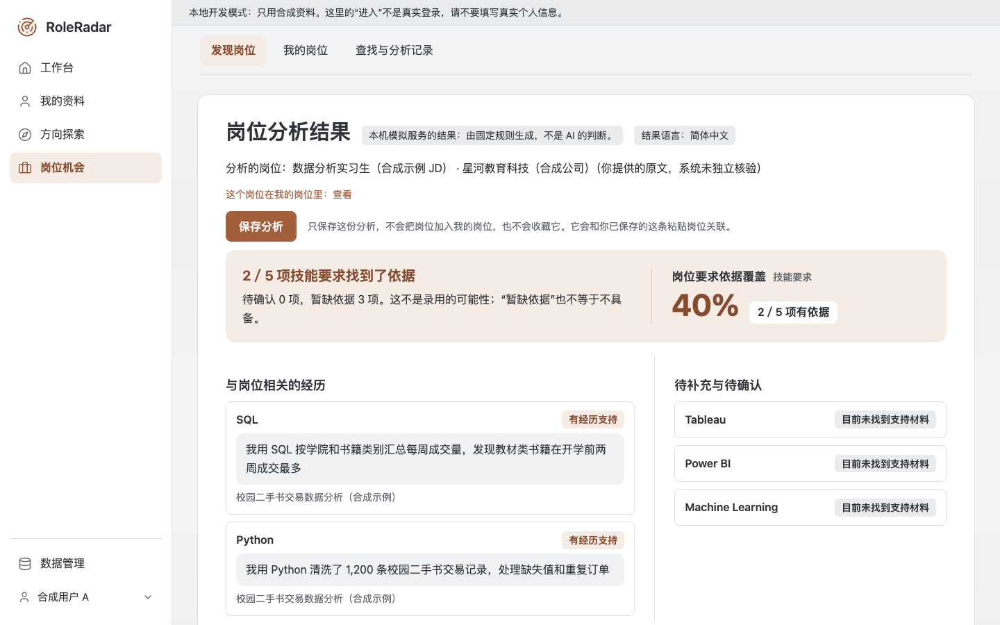

# RoleRadar

RoleRadar helps a student or early-career job seeker turn their own, confirmed experiences into job decisions they
can explain: which directions their experience supports, which postings fit, what each requirement is (or is not yet)
backed by, and what to keep for next time.

> **Publication status (2026-11-26; product baseline 2026-11-19).** A local, single-user interactive demo. By default it runs on synthetic data with a built-in
> simulated service, and it is **not deployed** anywhere. Real model and real job-source paths exist behind explicit
> approvals and were exercised only in a few small, separately approved runs (see
> [What is real and what is simulated](#what-is-real-and-what-is-simulated)).
>
> 中文演示指南、录屏脚本和现场讲稿：[docs/demo](docs/demo/README.md)。



*A synthetic job description analysed against the synthetic demo profile (Chinese UI). SQL and Python are backed by
sentences the user wrote about their own work; Tableau (done by a teammate), Power BI (only planned) and Machine
Learning are listed as not yet backed; the degree condition stays "unknown" for the user to check. The 40% is the
evidence coverage of the listed skill requirements (2 of 5), not a hiring probability or an overall fit score.*

## The problem

Students applying for internships and first jobs usually have real experience but find it hard to tell:

- which directions that experience actually supports;
- for a given posting, which requirements they can back with something they did, which are gaps, and which
  conditions (degree, start date, city) they have to check themselves;
- why a tool says what it says: most advice sounds confident without showing where it comes from.

RoleRadar keeps the person's own words as the evidence. An analysis quotes the experience sentence it relies on, says
when a sentence describes a teammate's work or only a plan, leaves hard conditions to the person instead of guessing,
and shows conflicts with their preferences separately.

## What the demo shows

One connected loop, on synthetic data:

1. **Confirmed experiences and preferences.** An experience library with drafts, confirmation and version history; job
   preferences per dimension (ideal / also acceptable / cannot accept, plus must-haves such as the earliest start);
   optional resume import that is read locally and reviewed before anything is adopted.
2. **Explore directions.** A fixed workflow suggests three to five directions with quotes from the selected
   experiences and how each relates to the preferences; the person keeps, defers or excludes each one.
3. **Find jobs, or add one.** A bounded discovery agent searches the synthetic job sources within the scope the person
   set (cities, job types, directions), reads and checks postings and analyses up to three of them; or the person
   pastes a job description they already have.
4. **Evidence-based analysis.** Requirements are shown as backed, not yet backed, or hard conditions; every citation is
   a quote of the person's own experience; preferences are compared line by line, and conflicts stand apart.
5. **Save and decide.** Keep a posting in *My jobs* with a personal decision (favorite, defer, skip, prepare to apply)
   and reasons; save analyses, search summaries and explorations to come back to later.

Before anything is sent to a service, the page shows which fields go out and to which service, and nothing is sent
until the person confirms.

More screenshots: [experience library](docs/demo/screenshots/02-experiences.png) ·
[direction exploration](docs/demo/screenshots/03-direction-result.png) ·
[job discovery](docs/demo/screenshots/04-discover-results.png) ·
[my jobs](docs/demo/screenshots/05-my-jobs.png) ·
[review before sending](docs/demo/screenshots/06-review-before-sending.png)

## Run the demo locally

The current demo is on **`main`**. You need git and Python 3.13 (the version the project is developed and tested
with). The demo scripts have been verified on macOS; Linux and Windows/WSL have not been verified. There is no
recorded video and no online trial yet; the demo runs on your own computer.

```bash
git clone --branch main https://github.com/walteryt0994/RoleRadar.git RoleRadar
```

```bash
cd RoleRadar && python3.13 -m venv .venv && .venv/bin/pip install -r backend/requirements.txt
```

Prepare a fresh synthetic demo library (always a new folder; an existing folder is never reused or overwritten), then
start it on this computer only:

```bash
.venv/bin/python scripts/demo/prepare_demo.py --dir ~/roleradar-demo/first-run
```

```bash
scripts/demo/run_demo.sh ~/roleradar-demo/first-run
```

Open <http://127.0.0.1:8850> and choose **以合成用户 A进入** (enter as synthetic user A). Stop the server with Ctrl-C;
to start over, prepare another new folder. The interface is Chinese by default and can be switched to English from the
user menu; the synthetic demo data itself is written in Chinese.

- The demo signs in through a development login for two synthetic users and only serves 127.0.0.1. It is not real
  authentication and must not be exposed to a network.
- `run_demo.sh` starts the app with an empty environment, so no API key or approval in your shell can reach it; on
  macOS it also runs inside a sandbox that allows local connections only.
- Search, exploration and analysis results are temporary: kept for 30 minutes and lost when the server restarts.
  Saved records stay in the demo folder. The preparation script saves a few records in advance as a fallback.
- Most top-level dependencies are not pinned yet, so a fresh install may get newer versions than the tested ones.

The step-by-step guide, the 3-minute recording storyboard and the 5-minute live script (in Chinese, with short English
lines) are in [docs/demo/README.md](docs/demo/README.md).

## What is real and what is simulated

**What the local demo uses**

- All people, experiences, companies and postings are synthetic and labelled as such.
- Direction exploration, job analysis and the discovery agent's decisions come from the built-in simulated service:
  fixed rules running in the same process, labelled on every page as local simulation, "not AI". They show that the
  workflows, checks and pages work; they are not model output.
- Job sources are synthetic boards defined in the code; their links use the reserved `.invalid` domain.

**Controlled real verification (separate from the demo)**

- The same workflows can use an OpenAI model through the official API, and the discovery agent can read one public job
  board through a controlled reader. Both need explicit, time-limited approvals that cap requests and an in-app
  budget; a gate records usage and pauses on defined failure conditions, including unknown usage. This is not a
  provider-side billing cap; cancellation only prevents later requests. The default stays simulated.
- These paths were exercised in a few small approved runs, always with synthetic profiles. Their records, approvals
  and costs are kept outside this repository; this demo package contains no real personal data or raw real-run job bodies.

**Not done, deferred or out of scope**

- Not deployed; no production authentication (only a development login for two synthetic users on this computer).
- No resume generation and no automatic applications (a later stage, U4, not started).
- The discovery agent has not shown a measurable benefit over a fixed workflow: in the approved real runs no valid
  feedback-driven adjustment of its plan was observed, and **U3 acceptance item 9 is recorded as not met**. The bounded
  agent is an architectural capability, not a demonstrated improvement.
- Deferred to a later stage (U6): saved analyses from real sources, scheduled real checks, closing and expiry on real
  sources, evidence for downgraded directions, and the failure branch of real re-checks.
- No web-wide crawling, no retrieval-augmented generation (RAG), no multi-agent system.
- Remaining browser checks are deferred: real 200% zoom and keyboard paths on every page, long tasks without
  JavaScript, loaders under reduced motion, screen readers, Safari and Firefox.

The project is planned in stages U0–U6. **U3 is stage-closed only within the owner's approved scope, not a full U3
acceptance pass.** Item 9 remains unmet, with no further real runs planned for this closeout. This demo adds the
accepted UI batch (bilingual interface and redesign); publishing it does not start U4 or deploy the application.

## How it is built

- **Web app:** Python 3.13, FastAPI, server-rendered Jinja2 pages with small progressive JavaScript (the main forms
  also work without JavaScript), uvicorn; SQLAlchemy over one SQLite file plus a private attachment folder per library.
- **Ordinary application logic:** the experience library and its versions, preferences, imports and review, job
  records and decisions, recycle bin, export, per-user isolation.
- **Fixed AI workflows:** structuring an imported resume, analysing a job, exploring directions. Each sends only what
  the person confirmed, asks for strict JSON, and checks the answer locally: a citation must be a quote of what was
  sent, weak bases (a teammate's work, a plan, a bare claim) are downgraded, and hard conditions are shown on their
  own and stay unknown unless the posting and the experience actually state them.
- **Bounded single agent:** discovery is a LangGraph loop of at most eight decisions over fixed tools (search, read,
  check, analyse, finish) inside the scope the person set; it cannot widen that scope.
- **Controls:** confirmation pages with fingerprints, outbound privacy checks, and a live gate for real services
  (approvals, request caps, a budget ledger, pause on unknown usage, cancellation).
- **Interface:** Chinese and English from one message catalogue.

The diagram and the main modules: [docs/architecture.md](docs/architecture.md).

## Tests and verification records

The tests run offline (network blocked, every database and file write in a temporary folder) through
`backend/tests/library/run_isolated.py`. Recorded results for the code of commit `90c8d09`
(`backend/app` fingerprint `7692dfee…`, 232 files):

- full offline regression run by Claude on the frozen code: 4,671 passed, 0 failed, 0 skipped (2026-11-19);
- independent run by Codex of the 17 affected test files: 402 passed (2026-11-19).

Publication review (2026-11-26): 274 selected offline tests passed; a fresh synthetic demo was prepared, saved
records were checked after an application restart, and eight local launcher checks passed. Product code is unchanged
from `90c8d09`. No real model or job-source requests were made. This review did not repeat the full suite, a fresh
dependency installation, or cross-platform browser testing.

These are records of those runs, not a live status; there is no CI. To run the suite yourself (it takes several
minutes):

```bash
cd backend && ../.venv/bin/python -B tests/library/run_isolated.py --root-parent "$(mktemp -d)" -q tests
```

## Repository layout

- `backend/app/web_main.py`: the current local web app (`python -m app.web_main`).
- `backend/app/library/`: experience library, preferences, imports, shared pages, styles and scripts.
- `backend/app/job_analysis/`, `backend/app/directions/`, `backend/app/discovery/`: job analysis, direction
  exploration, the discovery agent, job records and their pages.
- `backend/app/live_gate.py`, `backend/app/outbound_review.py`: the real-service gate and the outbound checks.
- `backend/app/i18n/`: Chinese and English messages.
- `backend/tests/`: the offline tests.
- `scripts/demo/`, `docs/demo/`: the demo package (preparation, start, fixtures, scripts, screenshots).
- `backend/app/main.py`, `frontend/`: the earlier V1/V2 application (FastAPI + Streamlit), kept for history.

## History

The development log of the earlier V1/V2 application (Day 1–27, Stage 1–7), as the README recorded it until
2026-11-03: [docs/history/README-v1-v2-development-log.md](docs/history/README-v1-v2-development-log.md).
