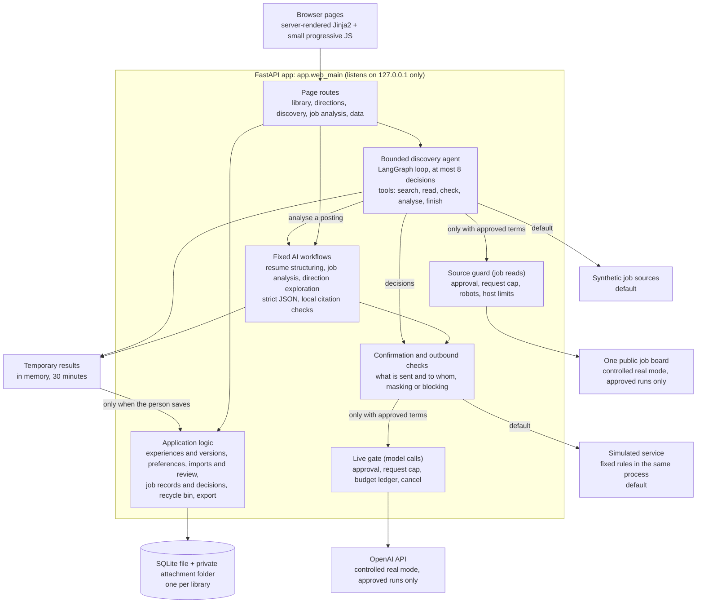

# RoleRadar architecture (local web app, as of 2026-11-19)

This describes the product baseline `90c8d09` and its demo package, published on `main` (publication review:
2026-11-26). It shows what exists; nothing here is deployed, and there is no cloud component, retrieval-augmented
generation (RAG) or multi-agent system.

## Three kinds of logic

- **Ordinary application logic** (no AI): the experience library with drafts, confirmation and versions; job
  preferences; resume import read locally in a child process and reviewed before adoption; job records with personal
  decisions; recycle bin, permanent deletion and export; per-user isolation. Modules: `app/library/`,
  `app/discovery/records.py`, `app/data_management.py`, `app/workspace.py`.
- **Fixed AI workflows**: a fixed sequence of requests with a fixed output contract.
  - Job analysis (`app/job_analysis/`, `app/experience_analysis.py`, `app/jd_service.py`): parse the posting, then
    assess each requirement against the selected experience fields. The answer must quote what was sent; local rules
    then decide the label (recognised teammate work, plans, negations and bare claims are downgraded), keep hard
    conditions apart, and compute the evidence coverage shown as a percentage (`app/evidence_coverage.py`). The
    percentage is the share of listed skill requirements with evidence, not a probability.
  - Direction exploration (`app/directions/`): one request suggesting three to five directions with quotes and a
    comparison with the preferences; the person keeps, defers or excludes each direction.
  - Resume structuring (`app/live_structuring/`, `app/library/candidates.py`): turns an imported resume into candidate
    entries the person reviews one by one.
- **Bounded single agent** (`app/discovery/agent.py`, `tools.py`, `runner.py`): within the scope the person
  confirmed (cities, job types, directions, sources), a loop of at most eight decisions chooses among fixed tools. The
  tools enforce the scope, the request limits and the outbound rules; the agent cannot widen the scope or skip a
  check. In the demo its decisions come from local rules too. In approved real runs with a model it did not show a
  measurable benefit over a fixed workflow (no valid feedback-driven adjustment was observed), so it is described as a
  capability, not an improvement. U3 item 9 remains unmet; the owner approved a scoped stage closeout, not full U3
  acceptance. Publication does not start U4 or authorise further real runs.

## Simulated mode and controlled real mode

- **Simulated (default, the demo):** `app/job_analysis/simulation.py` and `app/directions/simulation.py` answer every
  request from fixed rules inside the process; `app/discovery/synthetic.py` provides synthetic job boards. Pages label
  these results as local simulation, "not AI". Nothing goes over the network.
- **Controlled real mode (separate validation runs only):** an OpenAI model through `app/ai_provider.py` behind the
  live gate (`app/live_gate.py`), and a reader for one public job board (`app/discovery/lever.py`, `lever_live.py`)
  behind its own approval and host guard. Both start only when explicit, time-limited approval terms are set in the
  environment; the app refuses to start rather than silently falling back. The demo's `scripts/demo/run_demo.sh`
  starts the app with an empty environment, so it always runs simulated.

## Controls that apply in both modes

- A confirmation page (or, on the job search setup, the per-field choices next to the start button) shows which fields
  are sent and to which service; a fingerprint ties the confirmation to what is actually sent.
- Outbound checks (`app/outbound_review.py`, `app/library/outbound_resume.py`) mask contact details and stop text that
  looks like an address or is marked confidential.
- Citation and privacy checks are bounded rules, not a guarantee of semantic correctness or detection of every
  sensitive string. User review is still required. Real-mode budgets are application checks, not provider billing caps;
  cancellation stops later requests, not a request already sent.
- Results are temporary until the person saves them; saved analyses keep the quotes and the versions they relied on,
  and pages show when the underlying experience has changed since.
- Development sign-in for two synthetic users, local addresses only (`app/library/identity.py`); this is not real
  authentication.

## Storage

- One SQLite file and one private attachment folder per library, given at start (`--db`, `--files`); both must be
  outside the repository.
- Task results (searches, explorations, analyses) live in memory for 30 minutes and are lost on restart.
- The earlier V1/V2 application (`app/main.py`, `frontend/streamlit_app.py`) has its own database and is not used by
  the current web app; see [the history document](history/README-v1-v2-development-log.md).
